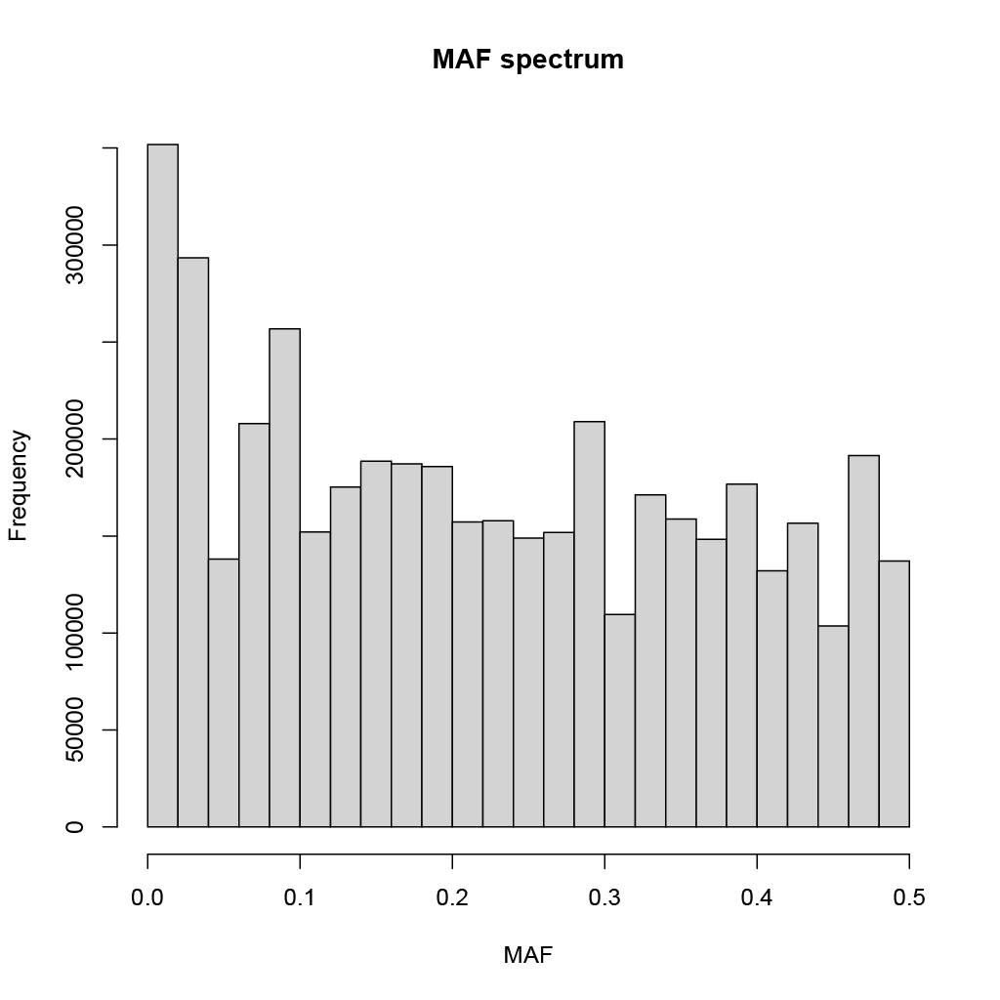

# Análisis de calidad de datos NGS

**Estudiante:** Pablo Valenzuela-Carvajal
**Profesor:** Dr. Ricardo Verdugo
**Curso:** Bioinformática e investigación reproducible para análisis genómicos
**Sesión:** 2.2
**Fecha:** 2026-08-10

---

## 1.1. Datos de genotipos

En esta sesión, dedicada a los datos de genotipos y su manipulación, se solicita desarrollar un script que permita realizar una serie de operaciones sobre un archivo VCF sin necesidad de copiar el archivo original al directorio de trabajo.

Los ejercicios propuestos son los siguientes:

1. Determinar el número de individuos y variantes (SNP) presentes en el archivo.
2. Contar los sitios que no presentan datos faltantes.
3. Generar un archivo que contenga únicamente los SNP ubicados en una ventana genómica de 2 Mb en cualquier cromosoma. El archivo debe guardarse en la carpeta `Sesion2/VCF/data` con el nombre `CLG_Chr<X>_<Start>-<End>Mb.vcf`, donde `<X>` corresponde al número del cromosoma y `<Start>` y `<End>` indican los límites de la ventana en megabases.
4. Determinar el número de variantes presentes en el archivo generado.
5. Calcular la cobertura promedio de cada individuo del conjunto de datos.
6. Calcular las frecuencias alélicas de los sitios y guardar los resultados en un archivo.
7. Filtrar el archivo de frecuencias para incluir únicamente variantes bialélicas.
8. Ejecutar un script en R que lea el archivo de frecuencias de las variantes bialélicas y genere un histograma del espectro de frecuencias del alelo menor (*Minor Allele Frequency*, MAF).
9. Contar los sitios cuya frecuencia del alelo menor sea inferior a 0,05.
10. Calcular las estadísticas de heterocigosidad de cada individuo.
11. Calcular la diversidad nucleotídica por sitio.
12. Filtrar el archivo para conservar únicamente los sitios cuya MAF sea igual o superior a 0,05.
13. Convertir el archivo `GATK_ChGdb_recalibrated.autosomes.12262013.snps.known.vcf` al formato PLINK.

Los 13 ejercicios se realizan mediante el script `script_vcf.sh`, ubicado en el directorio `../bin/` de esta carpeta del repositorio. El objetivo de este informe es explicar cada bloque de código e indicar qué ejercicios resuelve.

## 1.2. Preguntas 1 y 2: número de individuos, variantes y sitios sin datos faltantes

Los dos primeros ejercicios solicitan determinar el número de individuos y variantes presentes en el archivo, así como la cantidad de sitios que no presentan datos faltantes. Para ello, se utiliza el siguiente código:

```bash
VCF="/datos/compartido/ChileGenomico/GATK_ChGdb_recalibrated.autosomes.12262013.snps.known.vcf"

# Count variants
N_VAR=$(grep -v '^#' "$VCF" | wc -l)

N_IND=$(awk '{if ($1 == "#CHROM"){print NF-9; exit}}' "$VCF")

echo "Number of individuals: $N_IND"
echo "Number of variants:    $N_VAR"

# Count sites without missing data
NO_MISSING=$(vcftools --vcf "$VCF" --max-missing 1 2>&1 |
    awk '/After filtering, kept/ && /Sites/ {print $4}')

echo "Number of sites without missing data: $NO_MISSING"
```

En primer lugar, se define la ruta del archivo VCF mediante la variable `VCF`. A continuación, se almacenan los resultados en las variables `N_VAR` y `N_IND`.

Para contar las variantes, `grep -v '^#'` excluye las líneas de cabecera del archivo, mientras que `wc -l` cuenta las líneas restantes, que corresponden a los registros de variantes.

Por otra parte, `awk` identifica la línea que comienza con `#CHROM` y calcula el número de individuos restando las nueve columnas fijas del formato VCF al número total de columnas (`NF`). El comando `exit` detiene la búsqueda una vez encontrada esa línea.

Para determinar el número de sitios sin datos faltantes, se utiliza VCFtools con el argumento `--max-missing 1`, que conserva los sitios genotipados en todos los individuos. La expresión `2>&1` redirige la salida de error estándar hacia la salida estándar, lo que permite procesar los mensajes de VCFtools mediante `awk`. Este último identifica la línea que contiene las expresiones `After filtering, kept` y `Sites`, y extrae el cuarto campo, que corresponde al número de sitios conservados.

Los resultados se muestran en la Figura 1.


**Figura 1.** Salida de la consola de Ubuntu tras ejecutar `script_vcf.sh`. Se muestran el número de individuos, el número de variantes y la cantidad de sitios sin datos faltantes.

## 1.3. Preguntas 3 y 4: selección de una ventana genómica y recuento de variantes

Estos ejercicios solicitan generar un nuevo archivo VCF que contenga las variantes ubicadas en una ventana genómica de 2 Mb. En este caso, se selecciona una región del cromosoma 1 comprendida entre 1 y 3 Mb. Posteriormente, se cuenta el número de variantes presentes en el archivo generado.

```bash
# Create a 2 Mb window
CHR="1"

START_MB=1
END_MB=3

START_BP=$((START_MB * 1000000))
END_BP=$((END_MB * 1000000))

WINDOW_NAME="CLG_Chr${CHR}_${START_MB}-${END_MB}Mb"

vcftools \
    --vcf "$VCF" \
    --chr "$CHR" \
    --from-bp "$START_BP" \
    --to-bp "$END_BP" \
    --recode \
    --recode-INFO-all \
    --out "./$WINDOW_NAME"

mv "./${WINDOW_NAME}.recode.vcf" \
   "./${WINDOW_NAME}.vcf"

WINDOW_VCF="./${WINDOW_NAME}.vcf"

echo "The output file is: $WINDOW_VCF"

# Number of variants in the window
N_WINDOW=$(grep -v '^#' "$WINDOW_VCF" | wc -l)

echo "Variants in window: $N_WINDOW"
```

En primer lugar, se define el cromosoma mediante la variable `CHR` y los límites de la ventana en megabases mediante `START_MB` y `END_MB`. Posteriormente, las variables `START_BP` y `END_BP` convierten estos límites a pares de bases.

VCFtools utiliza los argumentos `--chr`, `--from-bp` y `--to-bp` para seleccionar las variantes que cumplen los criterios de ubicación establecidos. El argumento `--recode` genera un nuevo archivo VCF con las variantes seleccionadas, mientras que `--recode-INFO-all` conserva las anotaciones originales del campo INFO.

Debido a que VCFtools añade la extensión `.recode.vcf` al archivo generado, se utiliza `mv` para cambiar su nombre al formato solicitado. Finalmente, `grep` y `wc -l` permiten contar las variantes del archivo sin incluir las líneas de cabecera.

Los resultados se muestran en la Figura 2.


**Figura 2.** Salida de la consola de Ubuntu tras ejecutar `script_vcf.sh`. Se muestra el nombre del archivo generado y el número de variantes presentes en la ventana genómica seleccionada.

## 1.4. Pregunta 5: cobertura promedio por individuo

Este ejercicio solicita calcular la profundidad media de lectura de cada individuo mediante VCFtools.

```bash
# Calculate the mean depth
vcftools \
    --vcf "$VCF" \
    --depth \
    --out depth

echo -e "Mean depth per individual:\n$(head depth.idepth)"
```

El argumento `--depth` calcula la profundidad media de lectura por individuo, mientras que `--out` establece el prefijo de los archivos de salida (`depth`). Posteriormente, `head` muestra las primeras líneas del archivo `depth.idepth` en la consola, lo que permite inspeccionar los resultados.

Los resultados se muestran en la Figura 3.


**Figura 3.** Salida de la consola de Ubuntu tras ejecutar `script_vcf.sh`. Se muestran las primeras líneas del archivo con las estimaciones de profundidad media de lectura por individuo.

## 1.5. Pregunta 6: frecuencias alélicas

Este ejercicio solicita calcular las frecuencias alélicas de los sitios del conjunto de datos mediante VCFtools.

```bash
# Calculate allele frequencies
vcftools \
    --vcf "$VCF" \
    --freq \
    --out all_allele_frequencies

echo -e "Allele frequencies per site:\n$(head all_allele_frequencies.frq)"
```

El argumento `--freq` calcula las frecuencias alélicas de los sitios, mientras que `--out` establece el prefijo del archivo de salida (`all_allele_frequencies`). El resultado se almacena en `all_allele_frequencies.frq`.

Finalmente, `head` muestra las primeras líneas del archivo en la consola para facilitar la inspección de las frecuencias estimadas.

Los resultados se muestran en la Figura 4.


**Figura 4.** Salida de la consola de Ubuntu tras ejecutar `script_vcf.sh`. Se muestran las frecuencias alélicas estimadas para los primeros sitios del conjunto de datos.

## 1.6. Pregunta 7: frecuencias alélicas de variantes bialélicas

Este ejercicio solicita calcular las frecuencias alélicas exclusivamente para los sitios bialélicos, es decir, aquellos que presentan dos alelos.

```bash
# Calculate frequencies from biallelic sites only
vcftools \
    --vcf "$VCF" \
    --min-alleles 2 \
    --max-alleles 2 \
    --freq \
    --out biallelic_freq_output

echo -e "Allele frequencies for biallelic sites:\n$(head biallelic_freq_output.frq)"
```

El código utiliza los argumentos `--min-alleles 2` y `--max-alleles 2` para exigir que los sitios tengan exactamente dos alelos. De esta manera, se excluyen tanto los sitios monomórficos como los sitios multialélicos.

El argumento `--freq` calcula las frecuencias alélicas de las variantes que cumplen este criterio, mientras que `--out` establece el prefijo del archivo de salida (`biallelic_freq_output`). Finalmente, `head` muestra las primeras líneas del archivo generado.

Los resultados se muestran en la Figura 5.


**Figura 5.** Salida de la consola de Ubuntu tras ejecutar `script_vcf.sh`. Se muestran las frecuencias alélicas de los sitios bialélicos del conjunto de datos.

## 1.7. Pregunta 8: histograma de la frecuencia del alelo menor

Este ejercicio solicita ejecutar un script en R para generar un histograma de la frecuencia del alelo menor (*Minor Allele Frequency*, MAF) de las variantes bialélicas.

Desde Bash, se ejecuta el siguiente comando:

```bash
# Generate MAF histogram
Rscript script_maf_graph.R
```

El script de R se implementa de la siguiente manera:

```r
x <- readLines("biallelic_freq_output.frq")

x <- x[-1]

freq <- strsplit(x, "\\s+")

maf <- sapply(freq, function(x) {
    p1 <- as.numeric(sub(".*:", "", x[5]))
    p2 <- as.numeric(sub(".*:", "", x[6]))

    min(p1, p2)
})

pdf("MAF_histogram.pdf")

hist(
    maf,
    main = "MAF spectrum",
    xlab = "MAF"
)

dev.off()
```

El código comienza leyendo el archivo de frecuencias alélicas mediante `readLines()`, que almacena cada línea como una cadena de texto. Luego, se elimina la primera línea (`x[-1]`), correspondiente a la cabecera del archivo.

A continuación, `strsplit()` divide cada línea en campos separados por espacios en blanco, lo que permite acceder a las frecuencias de los alelos de cada sitio bialélico. Mediante `sub(".*:", "", ...)`, se elimina el texto anterior a los dos puntos y se extraen los valores numéricos de las columnas 5 y 6, que contienen las frecuencias alélicas en el formato esperado del archivo `.frq`.

Posteriormente, `min(p1, p2)` selecciona la menor de las dos frecuencias alélicas para cada sitio, obteniendo así su MAF. Finalmente, `pdf()` crea un archivo PDF para almacenar el histograma, `hist()` genera el gráfico y `dev.off()` cierra el dispositivo gráfico para guardar correctamente el archivo.

El histograma generado se muestra en la Figura 6.



**Figura 6.** Histograma de la frecuencia del alelo menor (MAF) de las variantes bialélicas analizadas. La distribución presenta una mayor concentración de variantes con frecuencias alélicas bajas.

## 1.8. Pregunta 9: recuento de sitios con MAF inferior a 0,05

Este ejercicio solicita contar los sitios cuya frecuencia del alelo menor es inferior a 0,05.

```bash
# Count sites with MAF <= 0.05
vcftools \
    --vcf "$VCF" \
    --max-maf 0.05 \
    2>&1 | awk '/After filtering, kept/ && /Sites/ {print $4}'
```

El argumento `--max-maf 0.05` conserva los sitios cuya MAF es igual o inferior a 0,05. A continuación, `awk` identifica el mensaje de VCFtools que informa el número de sitios conservados y extrae el valor correspondiente.

**Nota:** si el objetivo es contar exclusivamente los sitios con MAF estrictamente inferior a 0,05, este filtro no es suficiente, ya que también incluye los sitios con una MAF exactamente igual a 0,05. Para obtener el recuento estricto, sería necesario calcular o recuperar las MAF y contar únicamente aquellas que cumplan `MAF < 0.05`.

Los resultados del comando se muestran en la Figura 7.


**Figura 7.** Salida de la consola de Ubuntu tras ejecutar `script_vcf.sh`. Se muestra el número de sitios conservados por el filtro de MAF máxima de 0,05.

## 1.9. Pregunta 10: heterocigosidad por individuo

Este ejercicio solicita calcular estadísticas de heterocigosidad para cada individuo mediante VCFtools.

```bash
# Calculate heterozygosity
vcftools \
    --vcf "$VCF" \
    --het \
    --out heterozygosity

echo -e "Heterozygosity per individual:\n$(head heterozygosity.het)"
```

El argumento `--het` calcula estadísticas de heterocigosidad a partir de los genotipos de cada individuo, mientras que `--out` establece el prefijo del archivo de salida (`heterozygosity`).

El resultado se guarda en `heterozygosity.het`. Finalmente, `head` muestra sus primeras líneas en la consola para facilitar la inspección de las estadísticas calculadas.

Los resultados se muestran en la Figura 8.


**Figura 8.** Salida de la consola de Ubuntu tras ejecutar `script_vcf.sh`. Se muestran las estadísticas de heterocigosidad estimadas para los primeros individuos del conjunto de datos.

## 1.10. Pregunta 11: diversidad nucleotídica por sitio

Este ejercicio solicita estimar la diversidad nucleotídica por sitio mediante VCFtools.

```bash
# Calculate nucleotide diversity per site
vcftools \
    --vcf "$VCF" \
    --site-pi \
    --out nucleotide_diversity

echo -e "Nucleotide diversity per site:\n$(head nucleotide_diversity.sites.pi)"
```

Se utiliza el argumento `--site-pi`, que estima la diversidad nucleotídica para cada sitio del archivo VCF. Los resultados se almacenan en `nucleotide_diversity.sites.pi`, cuyo prefijo se define mediante `--out`.

Finalmente, `head` muestra las primeras líneas del archivo para inspeccionar los valores calculados.

Los resultados se muestran en la Figura 9.


**Figura 9.** Salida de la consola de Ubuntu tras ejecutar `script_vcf.sh`. Se muestran las estimaciones de diversidad nucleotídica para los primeros sitios del conjunto de datos.

## 1.11. Pregunta 12: filtrado por frecuencia del alelo menor

En este ejercicio se solicita filtrar el archivo VCF según la frecuencia del alelo menor, conservando los sitios cuya MAF sea igual o superior a 0,05.

```bash
# Filter sites with MAF >= 0.05
vcftools \
    --vcf "$VCF" \
    --maf 0.05 \
    --recode \
    --recode-INFO-all \
    --out GATK_MAF05
```

El argumento `--maf 0.05` establece el umbral mínimo de frecuencia del alelo menor. Por lo tanto, se conservan los sitios cuya MAF es igual o superior a 0,05.

Por su parte, `--recode` genera un nuevo archivo VCF que contiene las variantes que cumplen el criterio de filtrado, mientras que `--recode-INFO-all` permite conservar las anotaciones originales del campo INFO. El archivo resultante se genera con el prefijo `GATK_MAF05`.

Los archivos generados se muestran en la Figura 10.

## 1.12. Pregunta 13: conversión del archivo VCF al formato PLINK

El último ejercicio solicita convertir el archivo VCF original al formato PLINK.

```bash
# Convert to PLINK format
vcftools \
    --vcf "$VCF" \
    --plink \
    --out GATK_ChGdb_recalibrated
```

El código utiliza el argumento `--plink` de VCFtools para convertir los datos del archivo VCF al formato PLINK. Esta conversión genera archivos `.ped` y `.map`, que contienen, respectivamente, la información genotípica de los individuos y los metadatos de las variantes, incluidas sus posiciones genómicas.

El argumento `--out` establece el prefijo `GATK_ChGdb_recalibrated` para los archivos generados.

Los archivos de salida se muestran en la Figura 10.


**Figura 10.** Salida de la consola de Ubuntu tras ejecutar el comando `ls`. Los archivos resaltados en verde corresponden a los resultados generados por los dos últimos bloques del script: el filtrado por frecuencia del alelo menor y la conversión al formato PLINK.

# Conclusión 

El desarrollo de esta actividad permitió aplicar distintas herramientas de bioinformática para la inspección, el filtrado y la caracterización de datos genómicos en formato VCF. Mediante el uso de VCFtools, Bash y R, fue posible abordar tareas como el recuento de individuos y variantes, la identificación de sitios sin datos faltantes, la selección de regiones genómicas, el cálculo de frecuencias alélicas y la estimación de estadísticas de heterocigosidad y diversidad nucleotídica. Asimismo, se implementó un procedimiento para visualizar la distribución de la frecuencia del alelo menor mediante un histograma y se realizaron operaciones de filtrado y conversión a otros formatos de datos genómicos.

En conjunto, estos procedimientos son importantespara el control de calidad y la exploración inicial de los datos antes de realizar los análisis genéticos de interes de manera posterior. Además, la automatización de las tareas mediante scripts permite ejecutar los análisis de manera ordenada, reproducible y eficiente, reduciendo la necesidad de realizar operaciones manuales. Finalmente, esta actividad contribuyó a fortalecer el manejo de herramientas computacionales para el procesamiento de datos NGS y a comprender la utilidad de integrar distintos lenguajes y programas en un flujo de trabajo bioinformático reproducible.

