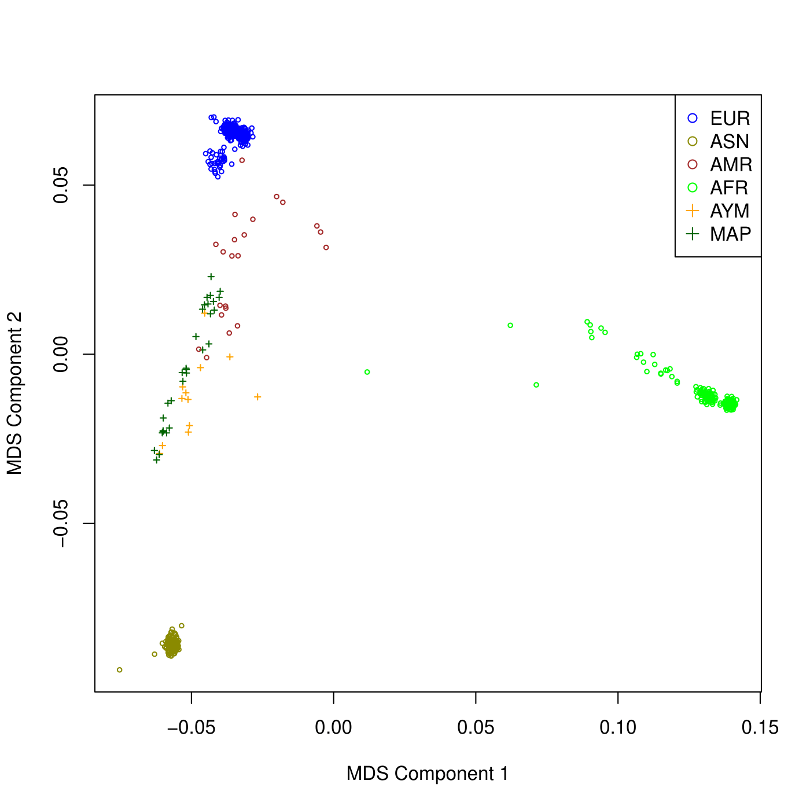
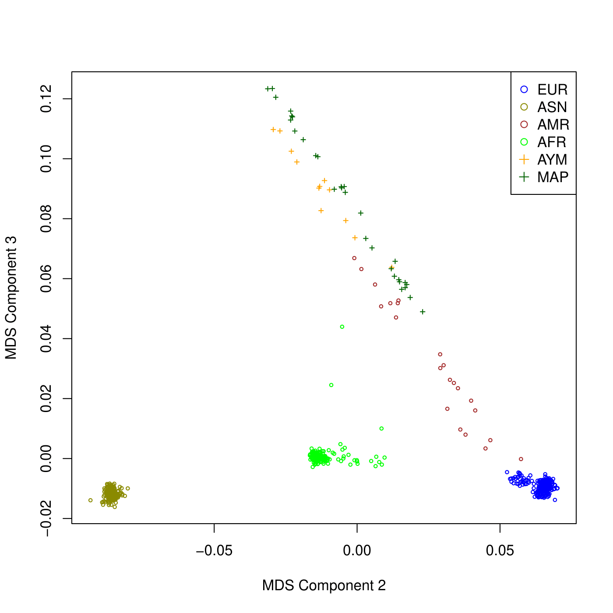
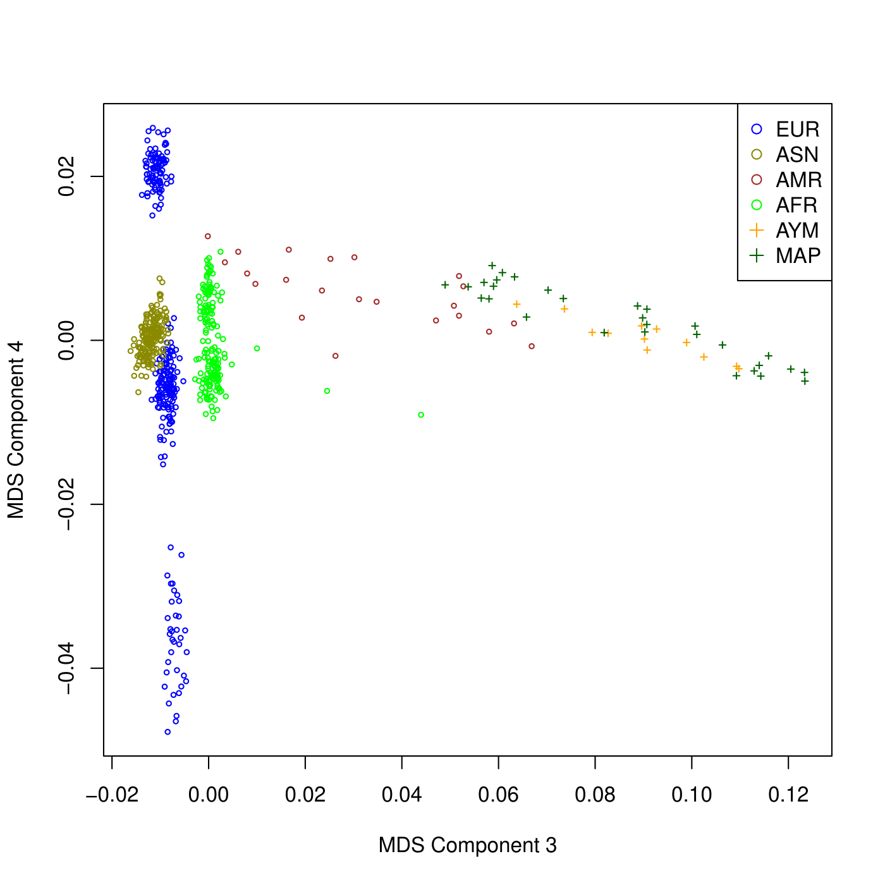
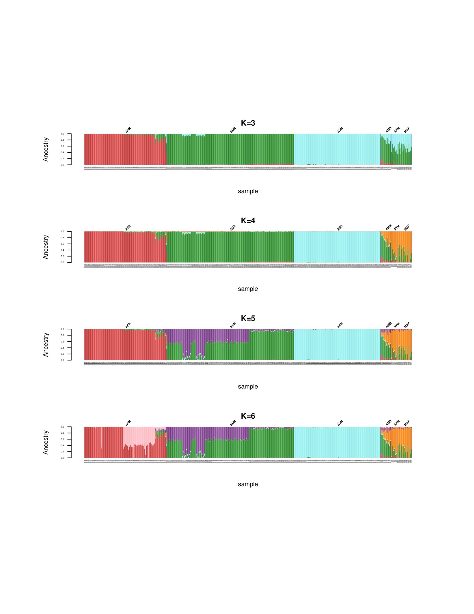
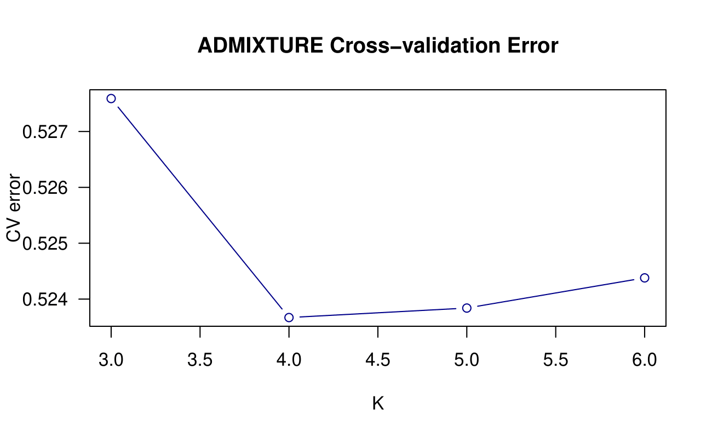

# Análisis genético poblacional

**Estudiante:** Pablo Valenzuela-Carvajal

**Profesor:** Dr. Ricardo Verdugo

**Curso:** Bioinformática e investigación reproducible para análisis genómicos

**Sesión:** 2.3

**Fecha:** 2026-08-10

---

# 1.1 Análisis genético de poblaciones

### ¿Cómo se llaman los archivos que contienen las tasas de datos perdidos por SNP y por muestra?

Los archivos que contienen las tasas de datos perdidos son aquellos con extensión `.lmiss` para los loci (SNPs) y `.imiss` para los individuos (muestras).

---

### ¿Cuántas variantes se eliminaron por tener una tasa de datos perdidos mayor a 0.2?

```bash
grep "variants removed" chilean_all48_hg19_2.log
```

Se eliminaron 4 680 variantes que presentaban una tasa de datos perdidos mayor a 0.2.

---

### ¿Cuántos individuos tenían una tasa de datos perdidos mayor a 0.02?

```bash
grep "people removed" chilean_all48_hg19_5.log
```

Ningún individuo fue eliminado por tener una tasa de datos perdidos mayor a 0.02.

---

### Basados en los histogramas y en sus cálculos, ¿qué valores umbrales de datos perdidos para muestras y SNPs sugeriría?

A partir de los histogramas presentados, considero que el umbral propuesto es una decisión adecuada. En el caso de los individuos, la mayoría presenta muy pocos datos perdidos y solo dos se escapan, mostrando más de un 10 % de datos faltantes. Esto podría deberse a una preparación deficiente del ADN o a su degradación, ya que los demás individuos no presentan niveles tan altos.

Respecto a los SNPs, también considero razonable un umbral entre 0.02 y 0.05; sin embargo, evaluaría cuántos SNPs se pierden con cada filtro, ya que si se eliminan demasiados con 0.02, relajaría el criterio. Cabe destacar que esta decisión es contextual y debe responder al objetivo de investigación por el cual se genotipificaron los individuos.

---

### ¿Cuántos individuos fueron eliminados por discrepancia de sexo?

```bash
wc -l sex_discrepancy.txt
wc -l chilean_all48_hg19_5.fam
wc -l chilean_all48_hg19_6.fam
```

Fueron eliminados 3 individuos por discrepancia de sexo.

---

### ¿Qué riesgo(s) se corre(n) si no se eliminaran?

Uno de los principales riesgos es que podrían ocurrir asociaciones falsas por sexo en los análisis posteriores, ya que si el sexo es una variable de interés, esta debe estar correctamente definida. Además, podrían surgir errores en análisis ligados a los cromosomas sexuales.

---

### ¿Cuál es el nombre del primer conjunto de datos que solo contiene SNPs en autosomas?

El primer conjunto de datos que solo contiene SNPs autosomales es `snp_1_22.txt`, a partir del cual derivan los demás sets utilizados en ese bloque, con el nombre `chilean_all48_hg19_7*`.

---

### ¿Cuántos SNPs se encontraban en cromosomas sexuales?

```bash
wc -l chilean_all48_hg19_6.bim   # SNPs totales
wc -l snp_1_22.txt               # SNPs autosomales
```

El primer archivo contenía 574 624 SNPs y el segundo 557 922, por lo que en los cromosomas sexuales se encontraban 16 702 SNPs.

---

### ¿Cómo calcularía el número de cromosomas que porta cada uno de los alelos para cada SNP?

```bash
plink --bfile chilean_all48_hg19_7 --freq counts --out allele_counts
awk '{print $2,$3,$4,$5,$6}' allele_counts.frq.counts | head
```

Podemos calcular el conteo del número de cromosomas que porta cada alelo con el comando `plink --bfile chilean_all48_hg19_7 --freq counts --out allele_counts` y luego inspeccionar el archivo generado mediante `awk`.

---

### ¿Cuál es el nombre del archivo con los resultados de la prueba de HWE?

El nombre del archivo es **`plink.hwe`**.

---

### ¿Basándose en la distribución de los valores de *p*, le parece el umbral usado razonable o propondría otro valor?

Me parece razonable, ya que el objetivo es detectar errores durante la genotipificación; los valores extremos estarían advirtiendo precisamente sobre este tipo de problemas.

---

### ¿Cuántos SNPs en aparente equilibrio de ligamiento se encontraron?

```bash
wc -l indepSNP.prune.in
```

Había **103 214 SNPs** en aparente equilibrio de ligamiento.

---

### ¿Cuántos SNPs se eliminaron por estar en regiones de inversiones conocidas?

```bash
grep "variants removed" indepSNP.log
```

Fueron eliminados 346 968 SNPs por estar en regiones de inversiones conocidas.

---

### ¿Cuántos individuos quedaron luego del filtro de parentesco?

```bash
wc -l chilean_all48_hg19_10.fam
```

Quedaron un total de 42 individuos luego del filtro de parentesco; es decir, se eliminaron 3 individuos.

---

### ¿Cuál fue el mayor coeficiente de parentesco efectivamente aceptado?

```r
rel <- read.table("pihat_min0.2.genome", header = T)
sub <- subset(rel, !IID1 %in% c("ARI001","ARI021","ARI018") &
                   !IID2 %in% c("ARI001","ARI021","ARI018"))
cat("Mayor PI_HAT aceptado:", max(sub$PI_HAT), "\n")
```

Se deben excluir los 3 individuos eliminados por el filtro dentro de la tabla `pihat_min0.2.genome`. El individuo con el mayor coeficiente de parentesco aceptado presentó un valor de 0.2005.

---

### En R, genere gráficos similares para las combinaciones Componente 2 vs 3 y 3 vs 4. ¿Qué puede concluir de estos gráficos?

<figure style="text-align: center;">
  
  <figcaption style="font-style: italic; color: #555; margin-top: 8px;">
    Figura 1: Gráfico MDS Componente 1 vs Componente 2.
  </figcaption>
</figure>

C1 y C2 capturan la mayor parte de la variación entre poblaciones (separan africanos, europeos y asiáticos). Los componentes de orden superior (C3, C4) capturan variación residual.

<figure style="text-align: center;">
  
  <figcaption style="font-style: italic; color: #555; margin-top: 8px;">
    Figura 2: Gráfico MDS Componente 2 vs Componente 3.
  </figcaption>
</figure>

En C2 vs C3, las poblaciones africanas siguen bien diferenciadas (C2 alto), mientras que C3 introduce una nueva separación que afecta principalmente a las poblaciones americanas y chilenas (AMR, AYM, MAP), las cuales se dispersan más en este eje. Esto sugiere que C3 captura parte del componente nativo americano.

<figure style="text-align: center;">
  
  <figcaption style="font-style: italic; color: #555; margin-top: 8px;">
    Figura 3: Gráfico MDS Componente 3 vs Componente 4.
  </figcaption>
</figure>

En C3 vs C4, las poblaciones de referencia (AFR, EUR, ASN) aparecen muy agrupadas (colapsan casi en un punto), mientras que AYM, MAP y AMR muestran alta dispersión. Esto indica que los componentes de orden superior reflejan diferencias individuales dentro de las poblaciones mestizas, probablemente relacionadas con distintos grados de mezcla.

---

### ¿Cuántos SNPs quedaron luego del filtro?

```bash
wc -l MDS_merge_r2_lt_0.2.bim
```

Quedaron un total de 70 534 SNPs.

---

### ADMIXTURE asume que los individuos no están emparentados. Sin embargo, no realizamos ningún filtro. ¿Por qué?

Ya se aplicó un filtro de parentesco en `chilean_all48_hg19_10` (se eliminaron ARI001, ARI021 y ARI018). Los individuos de 1000G no están emparentados por diseño del proyecto.

---

### Interprete la figura de ADMIXTURE y compare los resultados de los distintos K.

<figure style="text-align: center;">
  
  <figcaption style="font-style: italic; color: #555; margin-top: 8px;">
    Figura 4: Gráfico de ADMIXTURE para las poblaciones asiáticas, africanas, europeas y americanas desde K=3 hasta K=6.
  </figcaption>
</figure>

Para K=3: Se resuelven tres componentes mayores: africano (AFR), europeo (EUR) y asiático (ASN). Las poblaciones americanas (AMR de 1000G y las chilenas AYM/MAP) quedan mal representadas, ya que su ancestría se reparte artificialmente entre los componentes EUR y ASN, porque el modelo no tiene un componente propio para ella.

Para K=4: Aparece un cuarto componente que separa la ancestría de AMR. Este es el primer K en el que las muestras chilenas muestran un patrón biológicamente interpretable: mezcla de componente europeo + componente nativo americano, con contribución africana minoritaria en algunas muestras.

Para K=5: Se separa además el componente asiático en dos grupos, lo que puede indicar que existe un sobreajuste de K.

K=6: La fragmentación aumenta; se subdividen componentes que no corresponden a poblaciones ancestrales distintas (dentro de AFR, EUR y ASN). El modelo ya no es parsimonioso, por lo que es probable que exista un sobreajuste.

### Utilice un comando de Unix para extraer los valores de error de validación cruzada a partir de los archivos log.

```bash
grep "CV error" MDS_merge_r2_lt_0.2.K*.log
```

Con este comando podemos extraer los valores de error de validación cruzada a partir de los archivos log, utilizando grep y el signo * para que recorra los archivos.

```bash
MDS_merge_r2_lt_0.2.K3.log:CV error (K=3): 0.52759
MDS_merge_r2_lt_0.2.K4.log:CV error (K=4): 0.52367
MDS_merge_r2_lt_0.2.K5.log:CV error (K=5): 0.52384
MDS_merge_r2_lt_0.2.K6.log:CV error (K=6): 0.52438
```

### Genere un gráfico de línea en R donde k se muestre en el eje x y la tasa de error en el eje y.

<figure style="text-align: center;">
  
  <figcaption style="font-style: italic; color: #555; margin-top: 8px;">
    Figura 5: Gráfico de error de validación cruzada en función de K.
  </figcaption>
</figure>

Podemos ver que el K más óptimo para nuestro set de datos es K=4, ya que es el que presenta la menor tasa de error cruzado, lo que también es coherente con la interpretación biológica que le habíamos dado a los gráficos de ADMIXTURE.

# Conclusión

El desarrollo de este trabajo permitió conocer, a grandes rasgos, los principales análisis bioinformáticos que se utilizan para estudiar la estructura genética neutral de las poblaciones, además de los pasos de filtrado previos, tales como el desequilibrio de ligamiento o el equilibrio de Hardy-Weinberg. Asimismo, se pudieron interpretar con sentido biológico los gráficos generados mediante MDS y ADMIXTURE. En conjunto, los resultados mostraron que las muestras chilenas presentan una ancestría mixta, con un componente nativo americano y otro europeo predominantes, y una contribución africana minoritaria en algunas de ellas. Además, el menor error de validación cruzada obtenido para K=4 respaldó esta interpretación, lo que subraya la importancia de combinar criterios estadísticos con la interpretación biológica al elegir el número de componentes ancestrales de ADMIXTURE.
