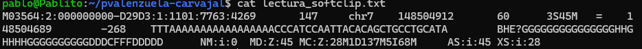
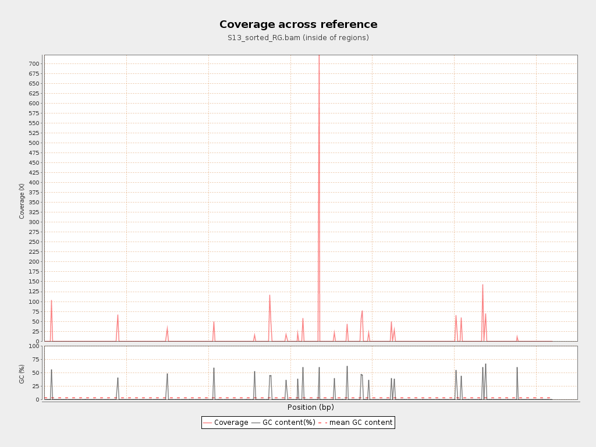
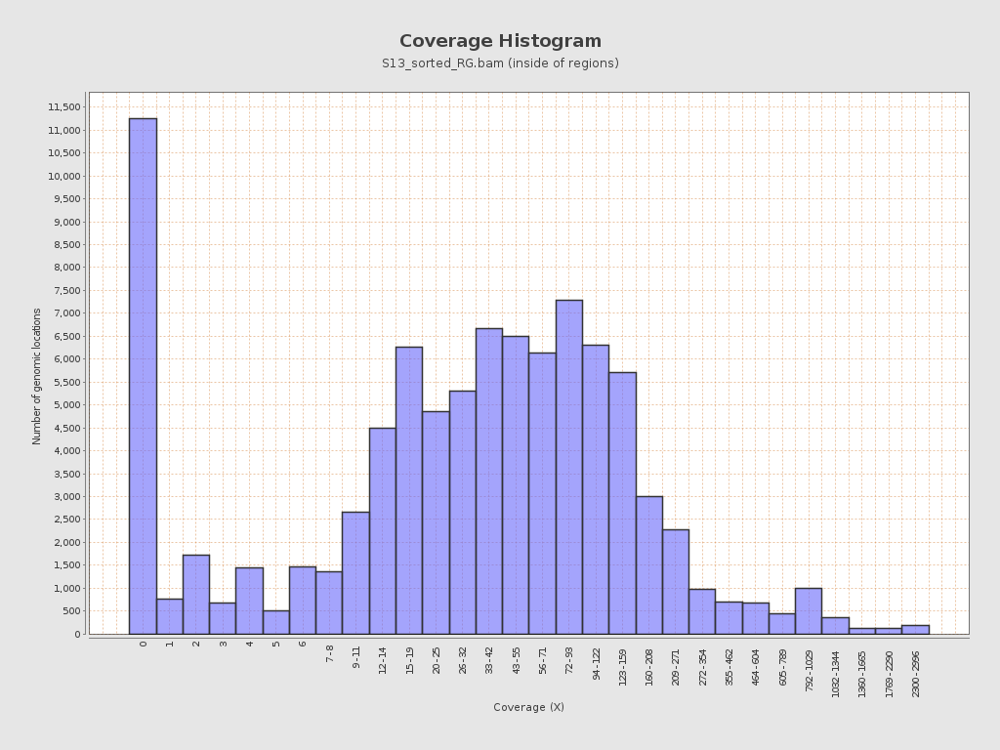
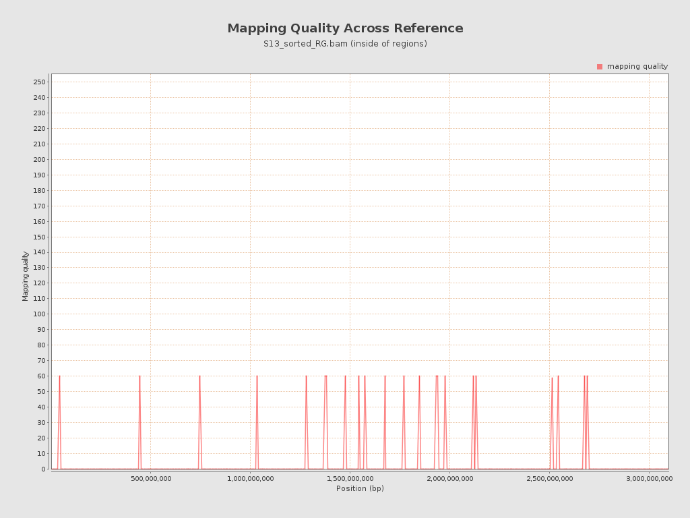
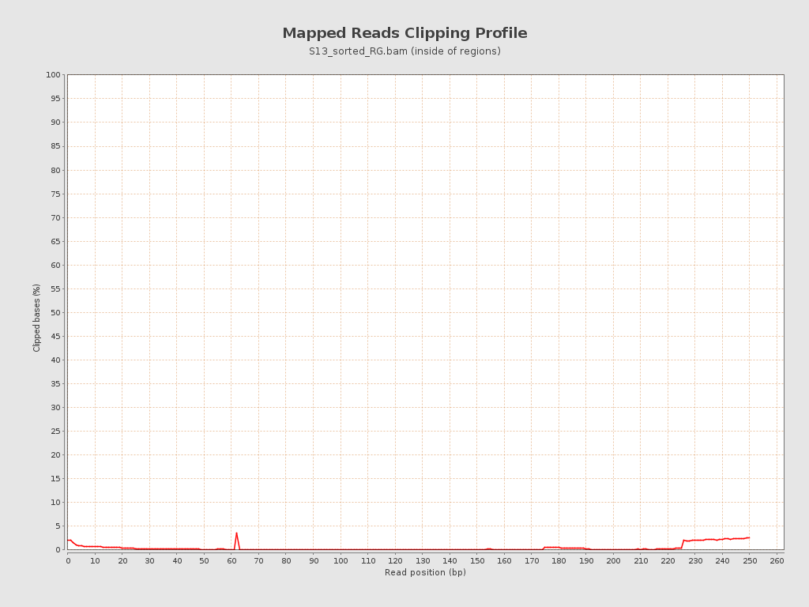
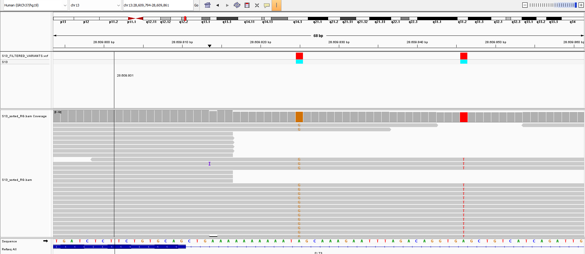

# Informe de alineamiento y control de calidad: muestra S13

**Estudiante:** Pablo Valenzuela-Carvajal

**Profesores:** Dr. Ricardo Verdugo 

**Curso:** Bioinformática e investigación reproducible para análisis genómicos

**Sesión:** 3.1

**Fecha:** 2026-24-11

## Introducción / Métodos

Se trabajará con las lecturas filtradas que se obtuvieron en las sesiones anteriores (S13_R1_filter, S13_R2_filter), alineadas contra hg19 con BWA-MEM para luego realizar la conversión a BAM, el ordenamiento y adición de Read Group con Picard, la indexación con samtools y control de calidad con Qualimap usando regiones_blanco.bed.

El número de genes únicos del panel corresponden a 27 genes (número que proviene de la exploración del archivo `genes_encestados.txt` generado en un trabajo anterior) que están distribuido en 369 regiones genómicas (el número proviene de explorar `regiones_blanco.bed`). El tamaño de la región se puede observar en el reporte generado por QualityMap el cual corresponde a 91.120 pb el cual se puede observar en Anexo 1.

Se utilizaron 2 scripts para realizar los análisis en BASH (`1. Llamado de variantes.sh`) y en R (`2. CADD anotations.R`)

**Tabla 1.** Numero de genes y nombres del gen de las regiones blanco.

| N.º | Gen | N.º | Gen | N.º | Gen |
|---:|:---|---:|:---|---:|:---|
| 1 | ABL1 | 10 | FLT3 | 19 | P2RY8 |
| 2 | BRAF | 11 | IKZF1 | 20 | PAX5 |
| 3 | BRCA1 | 12 | IL7 | 21 | PDGFRA |
| 4 | BRCA2 | 13 | JAK2 | 22 | PDGFRB |
| 5 | CALR | 14 | JAK3 | 23 | PTEN |
| 6 | CBL | 15 | KIT | 24 | RB1 |
| 7 | CEBPA | 16 | KRAS | 25 | SF3B1 |
| 8 | CRLF2 | 17 | MLL | 26 | TP53 |
| 9 | EZH2 | 18 | MPL | 27 | WT1 |

## Resultados

1. Utilizando una línea de comando, encuentre la primera lectura en el archivo SAM que contenga bases enmascaradas (secuencias suavizadas por soft-clipping)

La lectura que contentiene bases enmascaradas las buscaremos de la siguiente forma 

```bash

grep -v '^@' S13.sam | awk '$6 ~ /S/ {print; exit}' > lectura_softclip.txt

cat lectura_softclip.txt

```
Sabemos que el codigo CIGAR se encuentra en la columna 6, por lo que le pedimos con awk que se detenga al encontrar la primera coincidencia con una S en la columna 6. 

2. Muestre el registros de la lecturas en el archivo SAM e identifique y explique el código CIGAR de esa lectura.

Podemos explorar el archivo .txt que habiamos generado en el codigo anterior 



**Figura 1.** Salida de la consola de Ubuntu tras ejecutar `cat lectura_softclip.txt`. Se muestran diversos atributos de la lectura.

El codigo CIGAR de la lectura corresponde a "3S45M" que describe el alineamiento de la lectura de 48 pares de bases donde los primeros 3 nucleótidos presentan un recorte suave (soft clipping) al no coincidir con el genoma de referencia (conservándose en la secuencia del archivo), mientras que los 45 nucleótidos restantes se alinean directamente posición por posición contra la secuencia modelo.


3. Generar un reporte técnico de calidad del alineamiento con qualimap.

La evaluación de la calidad de los datos y del alineamiento de la muestra S13 se realizó mediante los calculos y graficos generadas por Qualimap a partir del archivo S13_sorted_RG.bam, considerando específicamente las regiones blanco del panel de genes. Los resultados muestran una distribución heterogénea de la cobertura, junto con valores elevados de calidad de mapeo y una proporción generalmente baja de bases recortadas (clipping) que persisten en el extremo de la secuencia (patron esperado de la secuenciación ilumina).

La cobertura a lo largo de las regiones de referencia presentó una distribución irregular (Figura 2). Se observan sectores con cobertura muy baja, mientras que otros presentan incrementos pronunciados, alcanzando un máximo cercano a 800X. lo que sugiere que la secuenciación no logró cubrir todas las regiones blanco de manera uniforme, estas diferencias podrían estar relacionadas con características propias de las regiones.




**Figura 2**. Cobertura a lo largo de las regiones de referencia de la muestra S13. El panel superior representa la profundidad de cobertura (X) en las posiciones genómicas incluidas en las regiones blanco, mientras que el panel inferior muestra el contenido de GC (%). 

La distribución de la profundidad de cobertura se puede observar en la Figura 3. Si bien una proporción importante de las posiciones presenta coberturas intermedias, principalmente entre 33X y 129X, también se observa una cantidad considerable de posiciones con coberturas muy bajas. Además, existe una cola hacia valores elevados, con posiciones que superan ampliamente las 200X. Las coberturas excesivamente elevadas podrían reflejar una representación desproporcionada de determinadas regiones, posiblemente. Algunas regiones presentan una profundidad suficiente para el análisis de variantes, pero esta condición no se cumple necesariamente para la totalidad del panel.




**Figura 3**. Histograma de la profundidad de cobertura de las regiones blanco de la muestra S13. El eje X representa los intervalos de cobertura (X), mientras que el eje Y indica el número de posiciones genómicas correspondientes a cada intervalo.

Respecto de la calidad del alineamiento, la distribución de la calidad de mapeo a lo largo de la referencia muestra valores cercanos a 60 en las posiciones donde se registra (Figura 4). Este valor corresponde a una calidad de mapeo elevada, lo que sugiere que las lecturas representadas se alinearon con alta confianza en el genoma de referencia. No obstante, esta métrica debe interpretarse junto con los resultados de cobertura, ya que una calidad de mapeo elevada no garantiza que todas las regiones blanco hayan sido cubiertas de manera adecuada. 




**Figura 4**. Calidad de mapeo (mapping quality) a lo largo de las regiones de referencia de la muestra S13. El eje X representa la posición genómica y el eje Y la calidad de mapeo de las lecturas.

Finalmente, el perfil de recorte de las lecturas muestra que la proporción de bases recortadas se mantiene generalmente cercana a cero a lo largo de la mayor parte de su longitud (Figura 5). Sin embargo, se observan incrementos puntuales, particularmente alrededor de la posición 62 y hacia el extremo final de las lecturas. Estos resultados sugieren que el soft clipping no constituye un problema generalizado en la muestra.



**Figura 5**. Perfil de recorte (clipping) de las lecturas alineadas de la muestra S13. El eje X representa la posición dentro de las lecturas (pb), mientras que el eje Y indica el porcentaje de bases recortadas. 

Brevemente, los resultados indican que el alineamiento presenta una calidad de mapeo elevada y una baja proporción de bases recortadas. Sin embargo, la principal limitación identificada corresponde a la distribución heterogénea de la cobertura.


4. Realice el filtrado de variantes con dos filtros, DP<10 y uno adicional que usted proponga. Estime cuántas variantes son eliminadas por el filtro DP<10 solamente, y cuántas por ambos filtros Y Genere un reporte e incluya una tabla con el número de variantes detectadas totales, SNPs, e INDELs. Para cada caso, indicar el número de variantes filtradas y que pasaron los filtros (solo uno, y ambos). 

Se aplicaron dos filtros independientes sobre el conjunto bruto de variantes. El primero es **DP<10** (solicitado en el enunciado), que descarta variantes con profundidad de cobertura inferior a 10 lecturas. El segundo es **QD<2.0** (QualByDepth), propuesto como filtro adicional. QD es la razón entre la confianza de la variante (QUAL) y la profundidad alélica (AD); valores bajos indican variantes cuya confianza no es proporcional a la cobertura que las soporta. 

Los filtros se aplicaron con nombres distintos (`LowDP` y `LowQD`) para cuantificar por separado el efecto de cada uno:

```bash
    $GATK -T VariantFiltration -R $REF -V S13_RAW_SNP.vcf \
      --filterExpression "DP < 10" --filterName "LowDP" \
      --filterExpression "QD < 2.0" --filterName "LowQD" \
      -o S13_FILTERED_SNP.vcf

    $GATK -T VariantFiltration -R $REF -V S13_RAW_INDEL.vcf \
      --filterExpression "DP < 10" --filterName "LowDP" \
      --filterExpression "QD < 2.0" --filterName "LowQD" \
      -o S13_FILTERED_INDEL.vcf

    $GATK -T CombineVariants -R $REF \
      --variant:foo S13_FILTERED_SNP.vcf \
      --variant:bar S13_FILTERED_INDEL.vcf \
      -o S13_FILTER_VARIANTS.vcf \
      -genotypeMergeOptions PRIORITIZE -priority foo,bar
```

Las variantes que superan ambos criterios quedan como `PASS`; las que fallan uno o ambos quedan como `LowDP`, `LowQD` o `LowDP;LowQD`.Luego a partir de la columna `FILTER` de los VCF filtrados se obtuvieron los siguientes conteos:

- Eliminadas solo por DP<10 (`FILTER = LowDP`): 2 SNPs y 0 INDELs = 2 variantes en total.
- Eliminadas por ambos filtros** (`FILTER = LowDP;LowQD`): 0 variantes.

En esta muestra los dos criterios resultaron mutuamente excluyentes: ninguna variante falló DP<10 y QD<2.0 a la vez. Los sitios problemáticos caen o por baja cobertura (con QD aceptable) o por baja calidad relativa a la cobertura (con DP suficiente), pero no por ambas causas simultáneamente. El filtro QD<2.0 fue el más restrictivo, eliminando 7 de las 9 variantes descartadas, y afectó de forma desproporcionada a los INDELs (3 de 12 INDELs, un 25 %, frente a 4 de 32 SNPs, un 12,5 %).

## 5. Tabla de variantes detectadas y efecto de los filtros

**Tabla 2**. Variantes detectadas en la muestra S13 y resultado del filtrado con DP<10 y QD<2.0.

| Tipo | Total detectadas | PASS | Solo LowDP | Solo LowQD | LowDP;LowQD | Total filtradas |
|------|:----------------:|:----:|:----------:|:----------:|:-----------:|:---------------:|
| SNP | 32 | 26 | 2 | 4 | 0 | 6 |
| INDEL | 12 | 9 | 0 | 3 | 0 | 3 |
| **Total** | **44** | **35** | **2** | **7** | **0** | **9** |

Del total de 44 variantes (32 SNPs + 12 INDELs), 35 (79,5 %) pasaron ambos filtros y 9 (20,5 %) fueron descartadas: 2 SNPs por DP<10 únicamente, 7 (4 SNPs + 3 INDELs) por QD<2.0 únicamente, y ninguna por ambos criterios. El conjunto final `PASS` (35 variantes) es el que se usó para la anotación con VEP y para IGV.

5. Visualizacion en IGV

Mediante IGV se pueden ubicar las variantes en el genoma de referencia y visualizar interactivamente diversos aspectos del alineamiento, como la profundidad de mapeo en un sitio o las lecturas que soportan cada alelo (Figura 6).


**Figura 6**. Visualización de dos variantes ubicadas en un intrón del gen FLT3 en el cromosoma 13 del GRCh37 con una profundidad de cobertura cercana a 60X. 


6. Ubicación de las variantes 

Del analisis de anotación con VEP logramos clasificar las variantes segun su consecuencia molecular, del total de 35 anotaciones de mayor impacto, 10 corresponden a variantes sinonimas, mientras que 7 corresponden a variantes intronicas, luego 6 corresponden a variantes en el cambio del marco de lectura. Las variantes missense fueron 5 mientras que las demas corresponden a categorias que presentan solo una variante como se puede ver en la Tabla 3. 

**Tabla 3**. Tabla con el tipo de variante y su frecuencia en el paciente S13 obtenidas a partir de VEP.

| Tipo de variante | Frecuencia |
|---|---:|
| Variante en la región 3' UTR | 1 |
| Variante de cambio de marco de lectura (*frameshift*) | 6 |
| Deleción en marco de lectura (*inframe deletion*) | 1 |
| Variante intrónica | 7 |
| Variante de cambio de sentido (*missense*) | 5 |
| Variante en región donadora de empalme e intrónica | 2 |
| Variante donadora de empalme | 1 |
| Variante en tracto de polipirimidinas e intrónica | 1 |
| Variante en región de empalme, tracto de polipirimidinas e intrónica | 1 |
| Variante sinónima | 10 |
| **Total** | **35** |

En conjunto, la distribución muestra un claro predominio de variantes candidatas a no tener efecto.

7. VEP

Las variantes que superaron los filtros de calidad de la sección 4 se anotaron con VEP (Ensembl, misma versión del genoma utilizada en el alineamiento), incorporando la significancia clínica de ClinVar y los puntajes CADD, fue sobre esta tabla se aplicó el filtro combinado ClinVar_CLNSIG distinto de benigno O CADD_PHRED > 20, del que resultaron cinco variantes en cuatro genes (Tabla 4). El analisis se realizo utilizando el script `2. CADD anotations.R`.

**Tabla 4**. Variantes filtradas por significancia clínica (ClinVar) o CADD > 20 (VEP) del paciente S13.
| # | Gen | Variante (Location Ref>Alt) | Consecuencia | IMPACT | CADD PHRED  | ClinVar (CLNSIG) | Criterio que cumple |
|---|-----|-----------------------------|--------------|--------|------------|------------------|---------------------|
| 1 | PDGFRA | 4:55140793 G>A | splice_donor_variant | HIGH | 33.0 | — (sin anotación) | CADD > 20 |
| 2 | KMT2A | 11:118368693 C>T | missense_variant | MODERATE | 28.7 | — (sin anotación) | CADD > 20 |
| 3 | CBL | 11:119149355 TATG>T | inframe_deletion | MODERATE | 21.4 | Uncertain_significance | Ambos criterios |
| 4 | CBL | 11:119169190 G>C | missense_variant | MODERATE | 26.6  | — (sin anotación) | CADD > 20 |
| 5 | FLT3 | 13:28624294 G>A | missense_variant | MODERATE | 21.0 | Benign | CADD > 20 |

La variante de posible mayor relevancia es 4:55140793 G>A en PDGFRA, un splice_donor_variant de impacto HIGH y CADD 33.0, sin anotación previa en ClinVar. Los fenotipos asociados son principalmente a cancer por lo que es la principal candidata a patogenicidad de la muestra.

En KMT2A se identificó una variante missense (11:118368693 C>T, CADD 28.7) sin anotación en ClinVar, los fenotipos principales son leucemias linfoblásticas agudas segun la anotación obtenida de ensembl.

El gen CBL concentra dos variantes: una inframe_deletion (11:119149355 TATG>T, CADD 21.4) clasificada como Uncertain_significance en ClinVar, y una missense (11:119169190 G>C, CADD 26.6) sin anotación clínica. 

Finalmente, la variante 13:28624294 G>A en FLT3 (missense, CADD 21.0) supera el filtro únicamente por el criterio CADD, ya que ClinVar la clasifica como Benign. Este caso ilustra una discordancia entre la predicción in silico y la evidencia clínica.

# Conclusiones

El alineamiento de la muestra S13 presentó una calidad de mapeo elevada y un bajo porcentaje de bases recortadas, aunque la cobertura de las regiones blanco fue heterogénea, con sectores de baja profundidad que podrían limitar la detección de variantes en esas zonas. Del total de 44 variantes detectadas, 35 (79,5 %) superaron ambos filtros de calidad. 

El filtro DP<10 eliminó solo 2 SNPs, mientras que QD<2,0 fue más restrictivo (7 variantes), sin que ninguna fallara ambos criterios simultáneamente. 

La caracterización por ubicación mostró un predominio de variantes sinónimas e intrónicas, aunque se identificaron 6 frameshift, 5 missense y 3 variantes en sitios de splicing con potencial impacto funcional.

Tras el filtrado clínico, destacó como hallazgo principal la variante 4:55140793 G>A en PDGFRA (splice_donor, IMPACT HIGH, CADD 33), sin anotación en ClinVar, que constituye la principal candidata a patogenicidad de la muestra. Se identificaron además dos variantes en CBL (un inframe deletion y una missense), una missense en KMT2A (CADD 28,7) y una missense en FLT3 clasificada como Benign, que ilustra una discordancia entre la predicción in silico y la evidencia clínica y no debe considerarse patogénica.
 
En conjunto, la muestra porta al menos una variante con potencial patogénico en PDGFRA, además de variantes de significado incierto, por lo que se requiere validación de lineas de evidencia independiente antes de establecer un diagnóstico molecular.


## Anexo 1. Reporte de QualityMap
Reporte completo de Qualimap: [qualimapReport.html](./results/S13_sorted_RG/qualimapReport.html)